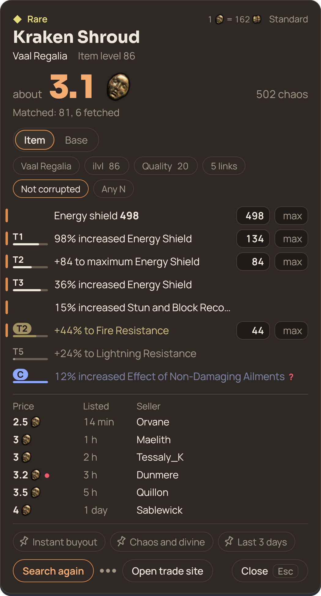

# Zenith Trade

A price-check overlay for Path of Exile 1, on Windows.

Hover an item, press a key, and a small panel next to the item tells you what it is worth and who is selling the same thing.

<p align="center"></p>

## What it does

- **Price check** (`Ctrl+D`) for gear, jewels, gems, maps, uniques, flasks and stackables. The panel opens with the item read and an estimate, then the listings arrive.
- **Filters you can tune in place:** each mod with its tier, minimum and maximum, a roll slider, pseudo totals (resistances, attributes, life), exclude a mod, "any N of these", pure tier, item level, quality, links, corrupted, influences, Foulborn, fractured base.
- **Currency and stackables** priced at once from a cached price list, with the 7-day trend and live bulk offers.
- **Map mods** (`Alt+D`): tag each map mod good, warning or danger, once, and see them on every map.
- **Quick menu** (`Shift+Space`): saved stash searches as buttons, map filter, settings.
- **Chat and stash keys:** `/hideout` and other commands on a key, `Ctrl+wheel` over the inventory to change stash tab, wiki page of the item.
- **Choices that stick:** buyout mode, currency, listing age; themes; every key can be changed.
- **Updates itself** from the releases of this repository.

## What it will never do

- Show ads, need an account, or ask for your session ID.
- Do more than one action in the game per key press, or act without one.
- Read the game's memory or files.

## Install

Download `Zenith-win-Setup.exe` from the latest release and run it. It installs for your user only (no admin rights) and adds a Start menu entry. Zenith Trade sits in the system tray; right-click its icon for the menu.

## Build

Needs Rust (stable, MSVC). From the repository root: `cargo build --release`.

The installer uses [Velopack](https://docs.velopack.io) and also needs the .NET SDK 8+ and its packer (`dotnet tool install -g vpk`), all free:

```
powershell -ExecutionPolicy Bypass -File installer\pack.ps1
```

This writes `target\releases\Zenith-win-Setup.exe` with the update packages beside it. The version comes from `crates/app/Cargo.toml`. Releases are built by the workflow in `.github/workflows`.

## Licence

The code is under the [MIT licence](LICENSE).

## Game content

Path of Exile, its name, item names and images belong to Grinding Gear Games. All rights reserved by Grinding Gear Games.

- The application icon and the installer image (`crates/app/assets/divine-source.png`, `crates/app/assets/zenith.ico`, `installer/splash.png`) are the Divine Orb image from Path of Exile, © Grinding Gear Games. They are not covered by the MIT licence.
- Currency, item and influence icons are not shipped: Zenith Trade downloads them while it runs from the game's content network and from the community wiki, and keeps them in a local cache.
- Prices come from the official trade site and from poe.ninja.
- The screenshot shows Divine Orb and Chaos Orb icons, © Grinding Gear Games.

Fan-made. This product isn't affiliated with or endorsed by Grinding Gear Games in any way.
